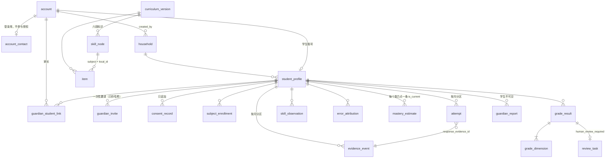
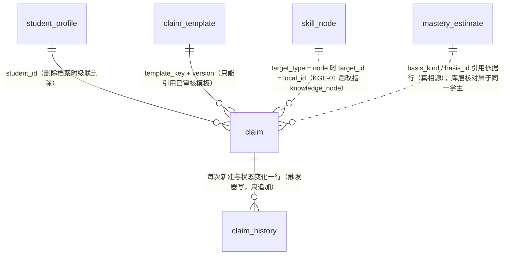
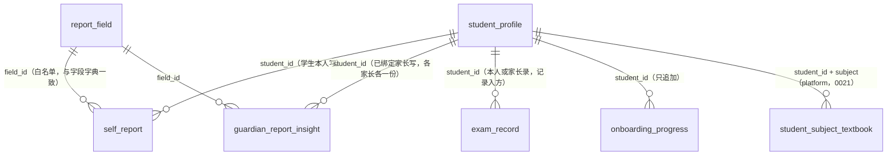
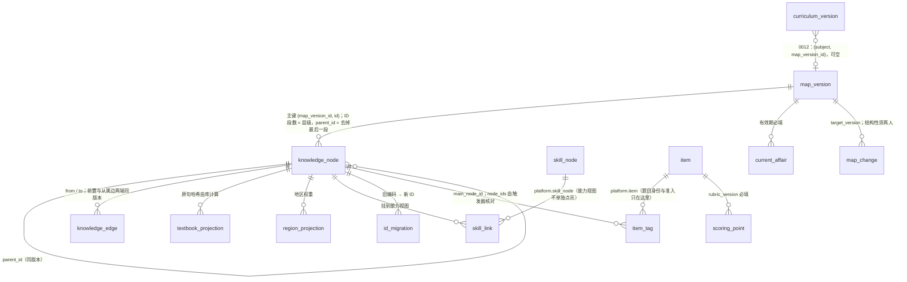
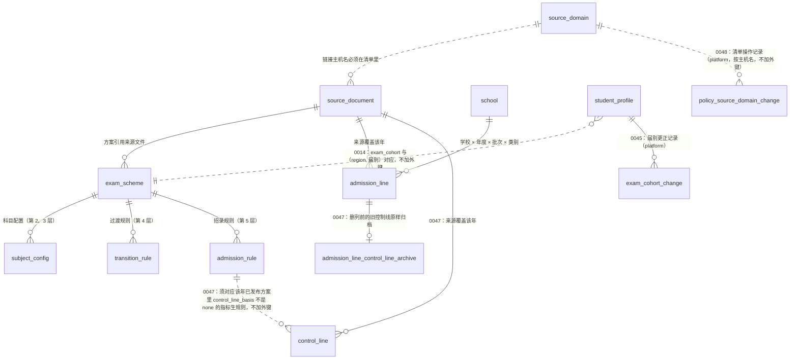

# 学习者 Schema v0.9 · ERD

状态：草稿（与 `db/migrations/0001`–`0006` 一致）。spec：`specs/learner-schema-v0.9/spec.md`。
依据：完整方案 v1.0 第四章、第 5.5 节、第七章；ADR 02、05、09。

## 三类数据分开存（CLAUDE.md 规则 6）

| 类别 | 表 | 谁写 | 学生可读 | 家长可读 |
|---|---|---|---|---|
| 身份与家庭 | account、account_contact、household、student_profile、guardian_student_link、guardian_invite、consent_record、subject_enrollment | BFF（受 RLS 与授权函数约束） | 自己的 | 已绑定学生的 |
| 内容登记 | curriculum_version、skill_node、item | 学习服务（发布闸门） | 已发布 / 已准入的 | 同左 |
| **原始证据** | evidence_event、attempt（按月分区） | 只有学习服务，只追加 | 自己的 | 已绑定学生的 |
| **模型推断** | skill_observation、error_attribution、mastery_estimate、grade_result、grade_dimension | 只有学习服务，只能更正不能改写 | 自己的 | 已绑定学生的 |
| **家长自述** | guardian_report | 写它的家长 | **不可见** | 只有写它的家长 |
| 复核 | review_task | 学习服务只能新建“待处理”；只有教研账号经 `resolve_review_task` 结案 | 否 | 否 |

## 关系图

推断表都用 `evidence_ids uuid[]`（至少一条）引用 evidence_event，没有建外键：证据表是分区表，而且证据与推断可能跨月。引用的完整性由学习服务在写入时保证。

## 授权模型

- **当前账号**：BFF 在每个事务开头 `SET LOCAL app.account_id = '<账号 UUID>'`。没有设置时，按账号的策略一律不放行（spec 待人确认 #1）。
- **授权函数**：`is_self_student`、`is_linked_guardian`、`can_read_student`、`can_read_household`。属主是 `starbuddy_authz`（BYPASSRLS，不授予任何登录角色），固定了 search_path。
- **家长访问**只看 `guardian_student_link` 中 `status = 'active'` 的记录。**手机号不参与任何授权判断**（规则 5）。
- **写入路径只有函数**：BFF 对账号、联系方式、家庭、学生档案、绑定、邀请都没有 INSERT 权限，只能调用属主为 `starbuddy_authz` 的函数：

| 函数 | 做什么 | 身份要求 |
|---|---|---|
| `signup_guardian(phone)` | 注册家长账号（BFF 在短信验证码通过后调用） | — |
| `lookup_accounts_by_phone(phone)` | 登录时按手机号查账号 ID | — |
| `create_student(...)` | 同一事务里建学生账号、档案与创建者绑定；可以新建家庭 | 有效家长；已有家庭必须是自己创建的 |
| `create_guardian_invite(student, ttl)` | 签发一次性邀请，库内生成邀请码，只存哈希 | 学生本人或有效绑定的家长 |
| `redeem_guardian_invite(token)` | 兑换邀请，建立绑定 | 有效家长；不是签发人；签发人此刻仍有权限 |

- **解除绑定**：只能 active → revoked，`revoked_at` 由库写入；同时作废被解除的家长为该学生签发的未用邀请。
- **更正推断**：新记录插入时不能带“已被取代”，创建时间由库写入；更正只能单向、一次，指向同一学生、同一对象、不更早且自身未被取代的记录（不会成环）；待复核的判分只能被同样待复核的判分取代，除非复核已由教研账号结案。
- **角色**：

| 角色 | 用途 |
|---|---|
| `starbuddy_bff` | 代表登录账号访问，受 RLS 约束 |
| `starbuddy_learning` | 唯一能写证据与推断的服务角色；读不到联系方式 |
| `starbuddy_review` | 教研复核后台：读复核队列、调用结案函数 |
| `starbuddy_authz` | 只作为授权函数的属主（NOLOGIN、BYPASSRLS、不授予任何角色） |

角色由 `db/bootstrap/roles.sql` 创建（人执行），迁移 0001 只断言属性：bff、learning、review 不能是 SUPERUSER 或 BYPASSRLS，不能被同一角色直接或间接同时继承。

## 分区（ADR 05）

- `evidence_event`、`attempt` 按 `occurred_at` 月分区，边界是 UTC 月初。初始建 2026-09 起 16 个月。
- 没有 DEFAULT 分区：超出范围的写入直接失败，便于发现“分区没建好”。
- 分区上不授予任何权限，只能经父表访问，所以父表的 RLS 一定生效。
- 主键 `(evidence_id, occurred_at)`：契约要求重试时返回同一个 evidence_id，所以用它作为幂等身份（spec 待人确认 #2，需要回写 ADR 05）。

## 与契约 v0.9 的对应

| 契约结构 | 表 |
|---|---|
| `EvidenceDraft` / `EvidenceRecord` | evidence_event（payload 白名单由 `evidence_payload_ok` 检查，与契约一致） |
| `AttemptInput` | attempt |
| `SkillObservation` | skill_observation |
| `ErrorAttribution` | error_attribution |
| `MasterySnapshot` | mastery_estimate（is_current） |
| `GradeResult` + 信封 | grade_result + grade_dimension |
| `review_reasons` | review_task |

库约束还补上了契约里表达不了的规则：
- 总分、维度分不超过满分；
- 有主观维度或 null 维度时，父判分必须复核，主观时父判分置信度 ≤ 0.5。这条是跨行约束，用约束触发器在事务提交时检查；
- 判分必须对应一次真实作答（外键），证据引用的题目必须已登记（外键）。

还没做到的跨表规则见 spec 待人确认 #12、#13。

## insight schema：判断账本（0010，SIE-00）

对学生的任何陈述都必须对应一条判断（CLAUDE.md 规则 11）。判断账本只由洞察服务 `starbuddy_insight` 写（ADR 13 草稿）。已有的个人层表留在 `platform.*`，`insight.*` 只放新增对象（对照文档 #3）。

| 表 | 谁写 | 谁读 | 要点 |
|---|---|---|---|
| `insight.claim_template` | 人工登记（必停项） | insight、learning、bff（只看已审核） | 可见范围上限；对学生或家长可见的必须有文本模板 |
| `insight.claim` | 只有 `starbuddy_insight`（无 DELETE，UPDATE 限定列） | bff 按学生本人 / 绑定家长与可见范围；learning 只看含 agent 的；都只看未过期、模板仍有效的非终态判断 | 五种状态，推翻与撤回为终态；每次写入带原因（行内 change_reason）；推断必须有证据、模型版本与依据行；到期时间不超过模板最长有效期 |
| `insight.claim_history` | 触发器（属主 `starbuddy_authz`） | 只有 insight | 每次新建与修改一行（原因加快照）；只能追加；只随判断级联删除 |

状态机：假设 → 成立 → 待验证 → 成立 / 推翻；任何非终态 → 撤回。每次写入都要在行里带原因，原因必须与流转匹配；不改状态的修改只能是 revised 或 visibility_changed；假设不能直接推翻（SIE-00 待人确认 #1）。判断是陈述层，不是第二真相源（规则 2）。

洞察服务的授权再核对（0044 草稿，SIE-02b 第二步）：BFF 代表学生本人或家长调用洞察服务时，洞察服务经 `insight.verify_actor(账号, 受众, 学生)`
（属主 `starbuddy_authz`，只授 `starbuddy_insight`，不新增任何表与表授权）按 `account`、`student_profile`、`guardian_student_link` 再核一次：
学生本人（active 学生账号且就是该档案的账号）或有效绑定的 active 家长才为真；档案已执行删除（0035 `erased_at`）、其他受众一律为假；只返回真假。

## insight schema：建档事实层（0021、0022，SIE-01）

建档写入的是事实（学生自述、家长观察、客观记录），不是判断；分表存放，两边说法不同时各存各的，不取平均（规则 6）。
写入由 BFF 以当前账号调用 SECURITY DEFINER 函数完成（待人确认 #3），BFF 没有任何表授权，只能经 `insight.onboarding_view` 读按身份裁剪的结果。

（图中 `guardian_report_insight` 即 `insight.guardian_report`，与 0006 的 `platform.guardian_report` 自由文本主题表区分。）

| 表 | 谁写 | 谁读 | 要点 |
|---|---|---|---|
| `platform.student_subject_textbook` | bff 经 `platform.set_subject_textbook`（本人或已绑定家长） | learning、insight；bff 只经 `onboarding_view` 读自己填的 | 按科、按填写账号各一行，两边说法不同都在；“不清楚”存 NULL；记来源（self / guardian）。`student_profile.textbook_version` 只作默认值，某科本表有行时以本表为准 |
| `insight.report_field` | 迁移（字段白名单） | 函数 | 与 `docs/design/sie/field-dictionary.v0.9.yaml` 一致（检查脚本） |
| `insight.self_report` | bff 经 `submit_self_report`（只学生本人） | insight；bff 只经 `onboarding_view`（学生本人） | 改答案：旧行写 `superseded_at`，新增一行；只有这一列可改（触发器） |
| `insight.guardian_report` | bff 经 `submit_guardian_report`（只已绑定家长） | insight；bff 只经 `onboarding_view`（写它的家长本人） | 学生看不到；另一位家长也看不到 |
| `insight.exam_record` | bff 经 `submit_exam_record`（本人或家长，记 `entered_by_role`） | insight；bff 只经 `onboarding_view` | 来源 = 录入方（self / guardian，手填不算客观记录）；排名区间与难度说明只收家长录入（表约束）；学生只见自己录的，家长见全部（两位家长共享）；同一录入方 24 小时最多 50 条 |
| `insight.onboarding_progress` | bff 经 `record_onboarding_step` | insight；统计只经 `onboarding_stats`（insight、report） | 只追加，不存答案；步骤名白名单；统计不足 5 人只给开始人数，窗口至少 1 天 |

新角色 `starbuddy_report`（运营报表只读身份）只能执行 `insight.onboarding_stats`，读不到任何明细（待人确认 #6）。

## kge schema：公共知识层（0011 与 0012，KGE schema v0.9）

公共知识层：地图版本、骨架、投影、原子与成长治理。唯一写入方是知识服务 `starbuddy_kge`；不含任何学生数据，也没有学生键（规则 13，攻击面测试断言）。对外只读工具用 `starbuddy_kge_read`（迁移 0026 草稿）：只读已发布版本里有效的节点、边、已核对投影、审核通过的标签、有效期内的时政，不能写任何表，读不到审核与治理对象，也没有任何 platform / insight / policy 表权限（`db/tests/79h_kge_reader.sql`）。规范见 `docs/design/kge/id-and-segments.md`，spec 见 `specs/kge-schema-v0.9/spec.md`。

| 表 | 谁写 | 谁读 | 要点 |
|---|---|---|---|
| `kge.map_version` | kge 建草稿；发布、撤下只能由 staff 经 `kge.publish_map_version` / `kge.retire_map_version`（0019，属主 authz） | learning、insight 全部；bff 只看已发布 | 草稿 → 已发布 → 撤下；同学科只一个已发布；非草稿只能改状态 |
| `kge.knowledge_node` / `knowledge_edge` | kge | learning、insight 全部；bff 只看已发布版本的有效行 | 七种类型、四个层级、五种范围；易错点必须写错因大类；只有计掌握度的类型带认知层次；细目只能是易错点或考点 |
| `kge.textbook_projection` / `region_projection` | kge | learning；bff 只看已发布版本里有效节点上的行，教材投影只看已核对的（核对人列不给 bff） | 已核对必须写核对人与时间 |
| `kge.skill_link` / `id_migration` | kge | learning | 学科与版本一致；撤销的旧编码没有新 ID |
| `kge.item_tag` / `item_family` / `scoring_point` / `current_affair` | kge | learning | 原子，不随骨架冻结，但在非草稿版本上只能挂有效节点；节点数组由触发器核对；题干、答案、解析不进库；采分点写入后不能修改（改内容发新 rubric_version），`point_id` 与判分维度对应 |
| `kge.curriculum_item` / `map_change` / `content_review` | kge 只提交待审；结论与状态只经签字函数（0019） | learning | 签字人是 staff 账号，存 `platform.content_signoff` / `map_change_signoff`（只追加）；签字记内容摘要，发布前重算比对；结构性变更（增删拆并节点、增删边）须两名不同 staff；审核记录只追加 |

骨架冻结：地图版本发布或撤下后，节点、边、投影、能力视图挂接、旧编码迁移都不能再新增或修改，改地图走新版本。任何角色都没有公共层的 DELETE，撤下走状态。
发布前校验 `kge.validate_map_version`：以下几项阻断发布，主考点题目少于 3 道只报警告。

- 环、传递边；
- 孤点；
- 缺包含、不包含、典型题例或认知层次，易错点缺识别特征；
- 悬空引用；
- 边类型与端点不符；
- 题目标签的层次不在主考点的层次集合里。

过期时政与指向未发布版本的跨版本边也只报警告，完整清单见 `docs/design/kge/id-and-segments.md` 第 4 节。
公共层的 jsonb 在任何层级都不能带学生、作答、账号等个人层的键（CHECK 约束 `kge.has_personal_key`）。

个人层计划中的改动（冲刺 1-C，未建，只在这里画出）：`platform.evidence_event` 增加 `evidence_kind`、`map_version`、`cognitive_level` 三列，分别记录证据种类、证据产生时的地图版本、证据对应的认知层次，与契约 `EvidenceDraft` 一起改（必停项）。

## policy schema：考情政策库与招录库（0013、0014；0045–0048 草稿）

公共基础数据：城市 × 中考届别的考试方案（五层），学校 × 年度 × 批次的录取数据，城市 × 年份 × 批次的指标生控制线。唯一写入方是 `starbuddy_kge`，不含学生数据。录入规范见 `docs/design/policy/data-entry-rules.md`。

| 表 | 谁写 | 谁读 | 要点 |
|---|---|---|---|
| `policy.source_domain` | 迁移或 DBA；0048 起有 `policy_source_admin` 权限的 active staff 经 `policy.add_source_domain` / `retire_source_domain`（只授 review） | kge、learning | 官方来源主机名清单；主机名规范化（小写、去结尾的点，不收 IP、通配符、端口、只有公共后缀的主机；0050 起不收不能往返解码的 xn-- 标签）；说明（发布机关）不含 Unicode Cc、Cf、Zl、Zp（0050 CHECK）；只下线不删行；登记人列写固定标记，操作者只记在 platform；0052 起新增与下线每次等清单行锁最多 5 秒（持续有登记时总等待可能更久；55P03“稍后重试”，审核台另有 10 秒客户端超时），来源文件守卫取锁后持锁事务空闲上限 60 秒（防程序出错的安全网） |
| `policy.source_document` | kge | learning；bff 看已发布与已撤下（0046），不看复核人 | https、主机名在清单里（0050 起核对时经 `policy.lock_active_source_host` 对清单行 FOR SHARE，与下线串行；`policy.url_host` 不收显式端口）、两人复核后发布；发布后只能更新核对日期或撤下；草稿不能直接撤下（0046） |
| `policy.exam_scheme` | kge（发布只能经 `policy.publish_scheme`，属主 authz） | learning；bff 看已发布与已撤下（往年方案，0046） | 同城市同届别只一个已发布；非草稿只能改状态；状态只能 草稿 → 已发布 → 已撤下（0046 起草稿不能直接撤下） |
| `policy.subject_config` / `transition_rule` / `admission_rule` | kge | learning；bff 看已发布与已撤下方案的（0046） | 方案发布后冻结；计分科目必须有满分；总分由库计算 |
| `policy.school` / `policy.admission_line` | kge | learning、bff（只看已复核学校与已发布招录行） | 分数不超过该年方案总分；来源覆盖该年；已发布行只能撤下，更正走新行；0047 起招录行没有控制线列 |
| `policy.control_line`（0047 草稿） | kge 只能新建草稿、改分数、来源与撤下；发布只经 `policy.sign_record`（两名不同 staff） | learning；bff 只看已发布，不看复核时间 | 城市 × 年份 × 批次 × 指标生一条已发布；对应该年已发布方案里需要控制线的招录规则；来源同城市、已发布、覆盖该年；不超过计分总分；已发布只能撤下，草稿不能直接撤下；没有自报复核人列 |
| `policy.admission_line_control_line_archive`（0047 草稿） | 只由 0047 写入 | kge、learning（bff 无权限） | 删列前招录行上的旧控制线（招录行 id、值、当时状态）原样归档；已撤下行的值只在这里 |
| `platform.policy_signoff`（0040 草稿） | 只经 `policy.sign_scheme` / `sign_record` / `publish_scheme`（属主 authz，只授 review，0041 草稿） | 任何应用角色都不能直接读；kge、review 经 `platform.policy_signoff_record()`（0040）导出 | 考情签字人是 staff 账号（policy 不存账号引用，规则 13）；签字记内容摘要，两名不同 staff 对当前内容批准才发布，同一账号对同一内容只签一次；只追加。0041 起来源文件、招录行、学校在第二名批准时发布，方案由签字身份发布，kge 不能直接改为已发布；0047 起也收控制线（`control_line_id`） |
| `platform.exam_cohort_change`（0045 草稿） | 只经 `platform.correct_exam_cohort`（属主 authz；授 bff 与 review） | 任何应用角色都不能读；0049 起家长导出（`platform.export_student_data`）带该学生的全部更正，只有旧值、新值、来源、时间 | 学生档案届别更正的最小记录：旧值、新值、来源（guardian_report / staff_correction）、操作者、时间；随删除请求删除；操作者不导出 |
| `platform.staff_permission`（0048 草稿） | 只由迁移或 DBA 授予 | review 只读自己的权限 | staff 的附加权限：`policy_source_admin`（0048）、`cohort_correction`（0049，客服更正届别）；库层守卫只认 staff 账号 |
| `platform.policy_source_domain_change`（0048 草稿） | 只经来源清单的新增、下线函数（属主 authz） | 任何应用角色都不能读 | 官方来源清单的操作记录（主机名、动作、说明、操作者、时间）；只追加；说明不含 Unicode Cc、Cf、Zl、Zp（0050 CHECK，引用 policy.has_hidden_chars） |

学生档案的届别（0045 起）：`exam_cohort` 是真相源，`grade` 是建档时年级；当前年级由 `platform.current_grade(exam_cohort, 时刻)` 推算（9 月 1 日切学年，不在 7–9 返回 NULL，时刻由调用方给）；
来源列 `exam_cohort_source`（derived / guardian_report / staff_correction；建档只收前两种，之后改届别必须同时改来源）。更正只经 `platform.correct_exam_cohort`：经 BFF 时须是有效绑定家长，经审核台签字连接时须是 active staff 且有 staff 权限 `cohort_correction`（0049；
无权限与学生不存在同一个错误），每次 ±1。家长导出的 profile 主题带 `exam_cohort` 与 `exam_cohort_source`，`cohort_changes` 主题带全部更正（0049）。
选科（`platform.enroll_subject`，写 `subject_enrollment`）0051 起在库里核对 `current_grade(exam_cohort, meter_now())` 在 7–9（先核授权，再对档案行 FOR SHARE 读届别），
不在时 55000 GRADE_OUT_OF_RANGE；暂停不查年级。
诊断会话 `platform.diagnosis_session.start_grade`（0049）记建立时用于选题的年级（会话参数，不是年级事实），学习服务据此发现会话中途届别被改；
`abandon_reason = grade_changed`（0049）记因届别变化放弃，这类放弃经 `platform.meter_refund_grade_changed`（只授 BFF）退回额度
（未结算的释放；已结算的写一条 adjust 流水，actor system，原因 grade_changed_refund；同一笔只退一次）。
只认 `diagnosis_full` 额度桶、来源方法 diagnose、幂等键与会话一致、同一学生的预留；退回量 = 结算量减已有更正（≤0 不退）；
同一学生同一额度期最多退一次（再有返回 conflict / limit）。写守卫触发器 `diagnosis_session_write_guard`：会话只能以进行中新建，
标 grade_changed 时库里按建立时刻核实年级确实变了（`platform.diagnosis_grade_changed`；没有 start_grade 的旧会话不能标）。

