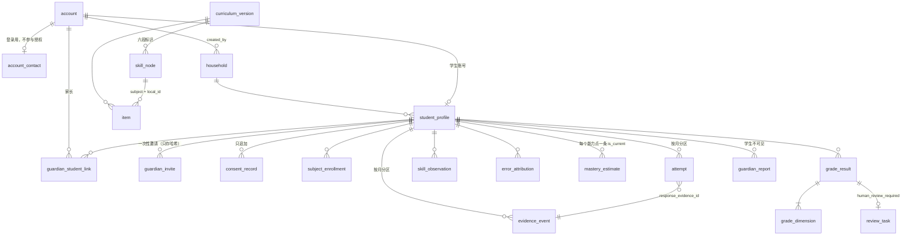

# 学习者 Schema v0.9 · ERD

状态：草稿（与 `db/migrations/0001`–`0006` 一致）。spec：`specs/learner-schema-v0.9/spec.md`。
依据：完整方案 v1.0 第四章、第 5.5 节、第七章；ADR 02、05、09。

## 三类数据分开存（CLAUDE.md 规则 6）

| 类别 | 表 | 谁写 | 学生可读 | 家长可读 |
|---|---|---|---|---|
| 身份与家庭 | account、account_contact、household、student_profile、guardian_student_link、guardian_invite、consent_record、subject_enrollment | BFF（受 RLS 与授权函数约束） | 自己的 | 已绑定学生的 |
| 内容登记 | curriculum_version、skill_node、item | 学习服务（发布闸门） | 已发布 / 已准入的 | 同左 |
| **原始证据** | evidence_event、attempt（按月分区） | 只有学习服务，只追加 | 自己的 | 已绑定学生的 |
| **模型推断** | skill_observation、error_attribution、mastery_estimate、grade_result、grade_dimension | 只有学习服务，只能更正不能改写 | 自己的 | 已绑定学生的 |
| **家长自述** | guardian_report | 写它的家长 | **不可见** | 只有写它的家长 |
| 复核 | review_task | 学习服务只能新建“待处理”；只有教研账号经 `resolve_review_task` 结案 | 否 | 否 |

## 关系图

推断表都用 `evidence_ids uuid[]`（至少一条）引用 evidence_event，没有建外键：证据表是分区表，而且证据与推断可能跨月。引用的完整性由学习服务在写入时保证。

## 授权模型

- **当前账号**：BFF 在每个事务开头 `SET LOCAL app.account_id = '<账号 UUID>'`。没有设置时，按账号的策略一律不放行（spec 待人确认 #1）。
- **授权函数**：`is_self_student`、`is_linked_guardian`、`can_read_student`、`can_read_household`。属主是 `starbuddy_authz`（BYPASSRLS，不授予任何登录角色），固定了 search_path。
- **家长访问**只看 `guardian_student_link` 中 `status = 'active'` 的记录。**手机号不参与任何授权判断**（规则 5）。
- **写入路径只有函数**：BFF 对账号、联系方式、家庭、学生档案、绑定、邀请都没有 INSERT 权限，只能调用属主为 `starbuddy_authz` 的函数：

| 函数 | 做什么 | 身份要求 |
|---|---|---|
| `signup_guardian(phone)` | 注册家长账号（BFF 在短信验证码通过后调用） | — |
| `lookup_accounts_by_phone(phone)` | 登录时按手机号查账号 ID | — |
| `create_student(...)` | 同一事务里建学生账号、档案与创建者绑定；可以新建家庭 | 有效家长；已有家庭必须是自己创建的 |
| `create_guardian_invite(student, ttl)` | 签发一次性邀请，库内生成邀请码，只存哈希 | 学生本人或有效绑定的家长 |
| `redeem_guardian_invite(token)` | 兑换邀请，建立绑定 | 有效家长；不是签发人；签发人此刻仍有权限 |

- **解除绑定**：只能 active → revoked，`revoked_at` 由库写入；同时作废被解除的家长为该学生签发的未用邀请。
- **更正推断**：新记录插入时不能带“已被取代”，创建时间由库写入；更正只能单向、一次，指向同一学生、同一对象、不更早且自身未被取代的记录（不会成环）；待复核的判分只能被同样待复核的判分取代，除非复核已由教研账号结案。
- **角色**：

| 角色 | 用途 |
|---|---|
| `starbuddy_bff` | 代表登录账号访问，受 RLS 约束 |
| `starbuddy_learning` | 唯一能写证据与推断的服务角色；读不到联系方式 |
| `starbuddy_review` | 教研复核后台：读复核队列、调用结案函数 |
| `starbuddy_authz` | 只作为授权函数的属主（NOLOGIN、BYPASSRLS、不授予任何角色） |

角色由 `db/bootstrap/roles.sql` 创建（人执行），迁移 0001 只断言属性：bff、learning、review 不能是 SUPERUSER 或 BYPASSRLS，不能被同一角色直接或间接同时继承。

## 分区（ADR 05）

- `evidence_event`、`attempt` 按 `occurred_at` 月分区，边界是 UTC 月初。初始建 2026-09 起 16 个月。
- 没有 DEFAULT 分区：超出范围的写入直接失败，便于发现“分区没建好”。
- 分区上不授予任何权限，只能经父表访问，所以父表的 RLS 一定生效。
- 主键 `(evidence_id, occurred_at)`：契约要求重试时返回同一个 evidence_id，所以用它作为幂等身份（spec 待人确认 #2，需要回写 ADR 05）。

## 与契约 v0.9 的对应

| 契约结构 | 表 |
|---|---|
| `EvidenceDraft` / `EvidenceRecord` | evidence_event（payload 白名单由 `evidence_payload_ok` 检查，与契约一致） |
| `AttemptInput` | attempt |
| `SkillObservation` | skill_observation |
| `ErrorAttribution` | error_attribution |
| `MasterySnapshot` | mastery_estimate（is_current） |
| `GradeResult` + 信封 | grade_result + grade_dimension |
| `review_reasons` | review_task |

库约束还补上了契约里表达不了的规则：
- 总分、维度分不超过满分；
- 有主观维度或 null 维度时，父判分必须复核，主观时父判分置信度 ≤ 0.5。这条是跨行约束，用约束触发器在事务提交时检查；
- 判分必须对应一次真实作答（外键），证据引用的题目必须已登记（外键）。

还没做到的跨表规则见 spec 待人确认 #12、#13。
