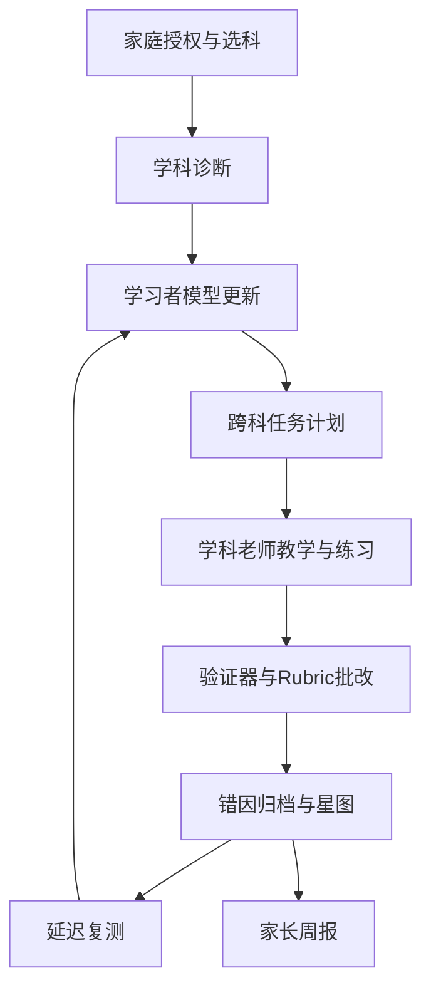
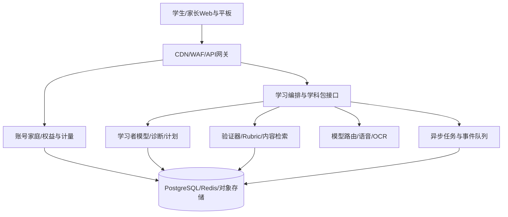

# 魁星点斗 StarBuddy AI 一对一学习平台
## 产品系统架构与技术实施蓝图 V2.0

2026-09-23 · 供产品、教研、研发、运营共同评审 · 设计方案，非已实现功能清单

## 1. 执行摘要

**定位**：面向初中生及家长，以南京中考为首个深耕地区，将“识别现有水平→定位失分根因→个性化教学→迁移练习→延迟复测→调整计划”做成一套长期服务。一个家庭账号下，学生按需选科；七科共享学习者模型和点点学伴，保留每科独立的教研、知识图谱、评测和 AI 老师。现有四科（语文、数学、英语、道法）优先整合，历史、物理、化学依次建设。

**用户承诺**：让学生清楚“我会什么、为何失分、下一步练什么、练后是否真的会了”；让家长看到可追溯的进步证据和本周一件可以做的事。避免承诺提分数值、押题或预测排名。星图只展示自己的能力进展，不做同伴排名。

**平台核心资产**：版本化的本地考情与学科内容、跨科能力与错因模型、经验证的批改体系、学生长期学习事件及教研审核流程。大模型作为可替换的推理与交互能力。

**对已有规划的增量**：四级会员与精确配额、统一业务与技术接口、数学化容量假设、成本闸门、发布门槛和实施验收；沿用《平台产品规划 v1.2》《七科 AI 老师角色规范 v1.1》，不另起人设或改变已定的四科产品名称。

## 2. 产品边界与三端

| 端 | 首页与核心操作 | 信息边界 |
|---|---|---|
| 学生端，移动网页先行，平板/PC 兼容 | 今日 20–40 分钟计划、学科星图、题目/拍照/语音输入、逐步讲解、错题再练、限时模考、点点跨科复盘 | 不展示其他学生数据；支持关闭陪伴功能、休息提醒；先练后看答案 |
| 家长端，同一家庭账号 | 授权与订阅、周报、错因趋势、各科使用与剩余额度、家长学院、学习计划协商 | 看证据和建议，不提供孩子的逐句私密对话或同伴排名；监护操作留痕 |
| 教研/运营管理端 | 图谱与题目版本、Rubric/验证器、批改抽检、内容审核、申诉复核、会员与成本分析 | 按岗位最小授权；教师或学校端为后期单独评估模块 |

**典型学习旅程**：家长建立家庭并授权→学生选科与目标→学段/教材/近期试卷录入→低门槛起点诊断→生成 2 周学习路径→每次 10–20 分钟微闭环→每周巩固与错题变式→2–4 周延迟复测→学生与家长分别看到星图和证据→系统更新路径。没有足够证据时显示“不确定/待验证”，不得把一次答对等同掌握。

诊断分三层：①免费 5–10 分钟入口筛查，标示粗略薄弱方向；②分科 20–35 分钟适应性诊断，输出能力点及可信度；③针对试卷或阶段模考的深度诊断，结合错因、耗时和作答过程。关键诊断在同等条件下复测，避免把题目熟悉度当作学习增益。

## 3. 七科学科包

每个包交付八件套：考情锚定、知识图谱、能力坐标与错因、学科闭环、Rubric 与验证器、人设及场景、审核过的内容、三视角报告模板。内容资产以`region/exam_year/grade/textbook_version/subject/content_version`标识；南京首发，以后按地区加包，不直接复制南京分值与题型。

| 学科与现有产品 | 老师与模式 | 首要学习闭环 | 可核验的评测 |
|---|---|---|---|
| 语文·文砺 | 妙笔，导师常驻 | 阅读审题/定位/表达、作文逐段修改 | 阅读采分点；作文多维 Rubric 与人工抽检 |
| 数学·阿鸦 | 阿鸦，导师常驻 | 知识点诊断、分级提示、变式与迁移 | 符号/数值/几何规则验证，步骤追踪 |
| 英语·开口成章 | 点点陪练、雅典娜考官 | 听说场景、发音改进、语法阅读 | ASR 识别与发音评估分开；评分 Rubric；低置信度复核 |
| 道法·知行 | 点点主持、方圆考官 | 读材料、定位概念、组织采分点 | 版本化教材依据与采分点 Rubric |
| 历史·知行·史 | 点点主持、春秋考官 | 时序、史料解释、因果与开卷检索 | 独立历史 Rubric；与道法共用限时合场训练 |
| 物理 | 阿基，导师常驻 | 猜想→交互实验→解释→迁移 | 单位/量纲/电路/光路/数值规则 |
| 化学 | X 博士，导师常驻 | 实验观察、方程式、推断链 | 配平守恒、化学式与推断约束 |

角色规范原有十条合同继续有效。学生前台每科主要见本科老师与点点，英语/道法的场景角色不判分；后台 Agent 可以负责出题、检索、验证、讲解、内容安全及评测。**讲解不能覆盖验证器或 Rubric 的结果**；置信度不足时提示复核或转人工。不以自发多角色对话消耗学生注意力。

## 4. 四级会员与权益引擎：首版供验证的配额假设

这里的“普通会员”指注册后的基础会员；价格、付费周期和具体额度均为产品实验参数，不代表对外承诺。PLUS、PRO、MAX 在同一家庭主账号下购买；第一版按**一个学生档案**计费，增设第二个孩子须单独购买学生席位，家长访问免费。学科开通采用权益矩阵：基础会员有限额体验四科；付费级别所含“同时开通科目数”与七科开放进度挂钩；尚未上线科目不纳入售卖承诺。

| 权益 / 每个学生每 30 天计量周期 | 普通 | PLUS | PRO | MAX |
|---|---:|---:|---:|---:|
| 同时开通科目 | 1 | 2 | 4 | 已上线全部（上限 7） |
| AI 互动有效时长¹ | 120 分钟 | 600 分钟 | 1,800 分钟 | 4,000 分钟² |
| 分科完整诊断 | 1 次入门筛查 + 1 次完整 | 2 次 | 6 次 | 12 次 |
| 限时整卷模考 | 0 | 1 次 | 4 次 | 10 次 |
| 新上传错题深度分析 | 20 题 | 100 题 | 300 题 | 800 题 |
| 讲评课堂/白板 | 文字与静态步骤 | 每月 10 节 | 每月 40 节 | 每月 100 节 |
| 语音实时互动 | 试听 10 分钟（计入总时长） | 60 分钟 | 240 分钟 | 600 分钟 |
| 周报与家长学院 | 基础周报、公共课 | 完整周报 | 跨科策略与月报 | 跨科深度报告、优先人工申诉 |

¹ 仅学生主动交互或播放课程时计费；暂停、等待队列、服务故障和后台生成不计；文字互动也有分钟配额，另外设置后台 token 成本闸门，防止“挂机”与超长输入。模考、诊断、错题各按相应次数计量，不因单次模型失败扣次。² MAX 是公平使用上限，非无限服务。体验数据可用于调整这些假设；升级当日差额补足、降级到期生效，避免双重扣次。

**计量规则**：每次请求分配 `usage_id` 与 `idempotency_key`；开始时预留权益，处理成功后按实际单位结算，失败回滚。重复上传同一题在 24 小时内复看不重复扣“新题分析”；同卷重试因服务错误不扣第二次；学生主动重新发起完整分析计新一次。月度重置日与明细在支付前后可见；到上限时保存学习进度并提供低成本自练题，不强迫续费。模考应限定卷型与时长，避免小测占用整卷次数。

**商业策略**：初期以免费筛查和已上线单科体验获客；四科稳定后推广“家庭 PLUS 两科”“PRO 四科”；七科实装后再开放 MAX 七科。价格不在未核算单位经济性与监管路径前给出。按科加购及初三冲刺专题可作为附加权益，但不能形成无法理解的叠加扣费。模拟考试和诊断必须保留可复核的服务交付记录及退款规则。

## 5. 业务流程与数据模型

**关键对象**：`household`、`guardian_student_link`、`student_profile`、`subject_enrollment`、`curriculum_version`、`knowledge_node`、`skill_node`、`item`、`item_exposure`、`attempt`、`evidence_event`、`mastery_estimate`、`error_attribution`、`diagnostic_run`、`study_plan`、`lesson_session`、`exam_run`、`rubric_result`、`content_review`、`subscription`、`entitlement`、`usage_ledger`、`appeal`、`consent_record`。作答原始证据、模型推断、家长自述分开存；模型推断记录算法版本、置信度、证据 ID 与更正历史。家长关系按档案授权，不可仅凭同手机号访问孩子数据。

掌握估计先使用可解释规则+BKT，累积足够题目参数与校准数据后试点 IRT；遗忘复习用间隔规则起步。星亮的默认门槛是不同题型多次正确、低提示依赖且间隔复测通过，由各科教研配置，防止“刷同题点亮”。跨科“审题力”等指标须有至少两科的明确证据，不作人格或心理诊断。

## 6. 技术系统架构与组件选择

| 层 | 首版建议 | 到 50万–100万注册用户时的演进 |
|---|---|---|
| 前端 | Next.js + TypeScript + React；PWA 优先、响应式三端；白板 SVG/Canvas，KaTeX 公式；SSE 流式讲解 | 静态资源 CDN；考试页面独立降级；必要时再做原生 App |
| API/业务 | TypeScript BFF 负责账号/权益/支付回调；Python FastAPI 负责诊断、内容编排和学科验证；OpenAPI 契约 | 无状态容器弹性扩容；服务按流量分域，而非首日微服务化 |
| Agent 编排 | 显式有限状态流程（诊断→计划→教学→批改→复测），学科工具注册；复杂多步环节才引入 LangGraph | 每一步幂等、超时、重试、审计；工作流长任务持久化与断点恢复 |
| 内容与知识 | Postgres 存版本化题库、图谱及作答；对象存储存图片/语音/课程资产；pgvector 仅用于经审核内容辅助检索 | 热门检索缓存、读副本/搜索服务按瓶颈加入；**答案依据来自图谱与审核内容** |
| 模型与语音 | 国内可商用模型作为首选，通过模型路由接既有 Anthropic/Gemini 开发链；OCR、ASR、TTS 可插拔；数学 SymPy/专用几何规则 | 按任务选成本/延迟/质量档，供应商限流与熔断；用户个人信息跨境传输另行评估，不默认调用境外 API |
| 存储与异步 | PostgreSQL（现有 Supabase 可做首期）、Redis（缓存/限流/短期会话）、S3 兼容对象存储、队列/Worker | 连接池、读写隔离、分区事件表、备份恢复演练；分析仓库单独承接报表 |
| 监控安全 | OpenTelemetry/日志/指标/链路追踪；WAF、私有对象存储、KMS 加密、RLS 与服务端权限；敏感日志脱敏 | 多可用区容灾、容量预警、成本仪表盘、内容与权益审计 |

**统一学科插件 API（建议）**：`diagnose(assessment_evidence, curriculum_version)`、`plan(mastery, constraints)`、`teach(skill_id, hint_level, learner_context)`、`grade(attempt, rubric_version)`、`generate_variation(item_id, constraints)`、`report(evidence_window)`。返回结构包括`result`、`evidence_ids`、`confidence`、`source_version`、`model_version`、`human_review_required`。四科可先经适配器接入，英语保留既有模型链路；不要求一次重写。

**内容发布闸门**：AI 草稿→可重复验证的确定性检查→学科教研抽检/审核→版本发布→线上申诉和错误回收；可个性化表达，但用于判分的题、答案、Rubric 与基础讲解要有审核版本。时政/当年考情有生效和失效日期。试卷拍照 OCR 低置信度先让学生确认题目，再判分。

**OpenMAIC 使用边界**：优先验证其课程 DSL、白板和“按脚本播放/学生插话转实时”的呈现模式，先以一张试卷生成讲评课做技术原型。它不能替代平台的学习者模型、学科评分和权益系统。实际引入的仓库/子包须锁版本、核对每个依赖的许可证；渲染器不承担学生隐私数据的持久化。

## 7. 100 万用户容量与成本假设

“100 万用户”定义为累计注册学生上限，以下是**待压测的规划假设**，不是已验证容量：日活 15%=15 万；高峰同时在线为日活的 5%=7,500；其中 10% 正在等待 AI 流式回答=750 个模型并发；平均模型调用占用 20 秒，对应约 **37.5 次新请求/秒**。按两倍突发峰值规划约 **75 次请求/秒、1,500 个模型并发**；实时语音、OCR、模拟考试另建池，不与文字聊天共抢额度。模型 token 与输出速度会改变容量，须按供应商配额和 p95 输出长度实测。

| 阶段 | 用户规模与触发条件 | 建设动作与验证指标 |
|---|---|---|
| 内测 | 1千–1万注册；四科部分上线 | 单库单区域、异步批改、单模型故障降级；验证成绩正确率和错题处理 |
| 增长 | 1万–10万注册；稳定周活 | 队列、缓存、连接池、分学科限流、负载与成本仪表盘；2倍峰值压测 |
| 规模 | 10万–50万注册 | 独立 Worker、分科资源池、分析数据隔离、供应商多路容灾、备份恢复演练 |
| 上限准备 | 50万–100万注册，连续实际峰值证明需要 | 读副本/分区/热点数据迁移、多区域容灾按业务要求评估；分批扩容并复测 |

容量公式：`新请求率 ≈ 模型并发 / 平均占用秒数`。首次性能目标可定：非 AI API p95 < 500ms；文字首 token p95 < 3s（排除模型故障）；诊断异步任务 p95 < 90s；可用性月度 ≥99.9%（仅作为目标，按预算和供应商 SLA 调整）。压测同时覆盖模考开考、支付回调、流式断线重连、队列积压及单模型失效；各档用户享有**教学质量相同**的核心批改口径，差异主要是服务量与呈现能力。

**单位经济模型**：`单月每位活跃学生成本 = 模型输入/输出 token × 实际单价 + 语音分钟 + OCR页数 + 存储/带宽 + 教研审核摊销 + 客服/支付成本`；`毛利 = 净收入 - 可变服务成本`。每种会员分别观察 P50/P90/P99 成本、异常账户消耗；上线前用真实会话测算，而非在此写死价格。用题库复用、预生成、短上下文、任务模型路由及缓存降低成本；不得缓存跨学生隐私输出。

## 8. 未成年人、安全与上线前决策

面向境内初中生销售前，必须对**学科类 AI 一对一服务是否构成线上学科培训**取得具体业务形态的专业判断；“自主学习工具”宣传口径不能代替分类认定。同步梳理属地教育、电信与网信要求、收费/退费和已备案模型调用的应用登记适用性。支付主体为家长，监护人同意、年龄适配、AI 身份显著提示、时长控制、危机转介、学习对话删除/导出、未成年人数据最小化、供应商数据协议是设计输入。特别防止“点点”角色被理解为现实中的同学、鼓励依赖，或对心理健康作诊断。

审核指标：各科评分与人工教师的一致率、错误判分率、可追溯证据覆盖率、低置信度转人工率、身份/角色漂移与禁语率；有造成系统性误判的故障时可一键停用该评分版本并重新计算受影响报告。

## 9. 交付顺序与决策门

| 阶段 | 时间（估算） | 可验收交付物 | 通过条件 |
|---|---|---|---|
| 0 基座 | 0–3 个月 | 学习者 Schema、学科包 API、统一家庭关系、计量账本、模型路由、教研发布流水线；四科适配器原型 | 四科能写入同一学生模型，家长隔离与扣次幂等通过测试 |
| 1 四科产品 | 3–9 个月 | 今日计划、四科诊断/教学/错题闭环、点点、周报、会员四级；数学白板讲评 | 批改可靠，试点用户 8 周延迟复测改善且续用；合规路径明确 |
| 2 七科 | 9–18 个月 | 历史→物理→化学八件套；开卷双科合场训练；实验模板；MAX 七科权益上线 | 每科经教研发布与压测，线上口径和可用权益一致 |
| 3 规模化 | 按真实增长触发 | 从 10 万逐级到 100 万注册的容量与成本优化、地区包复制 | 每级峰值 2 倍演练、成本与容灾指标达标 |

**优先拍板的五件事**：①首发地区与教材版本；②现有四科系统的数据字段和真实可用状态；③首期监管分类与收费主体；④四级额度与可承受的每活跃学生成本；⑤英语是否保持独立技术栈（建议适配接入）。这五项是实施参数，不阻断今天讨论架构与启动基座工程。

## 参考依据

- 项目现有《魁星点斗 StarBuddy 平台产品规划 v1.2》《七科 AI 老师角色规范 v1.1》《OpenMAIC 借鉴分析 v1.0》及附带 OpenMAIC README（2026-09-23 提供）。
- [教育部《全国校外教育培训监管与服务综合平台应用管理办法》](https://www.moe.gov.cn/srcsite/A29/202503/t20250326_1184786.html)。
- [《未成年人网络保护条例》](https://www.cac.gov.cn/2023-10/24/c_1699806932316206.htm)、[《个人信息保护法》](https://www.cac.gov.cn/2021-08/20/c_1631050028355286.htm)、[《生成式人工智能服务管理暂行办法》](https://www.cac.gov.cn/2023-07/13/c_1690898327029107.htm)、[《人工智能拟人化互动服务管理暂行办法》](https://www.cac.gov.cn/2026-04/10/c_1777558395078289.htm)。
- [Supabase 官方连接池说明](https://supabase.com/docs/guides/database/connecting-to-postgres/pooling-and-limits)与[只读副本说明](https://supabase.com/docs/guides/platform/read-replicas)。
