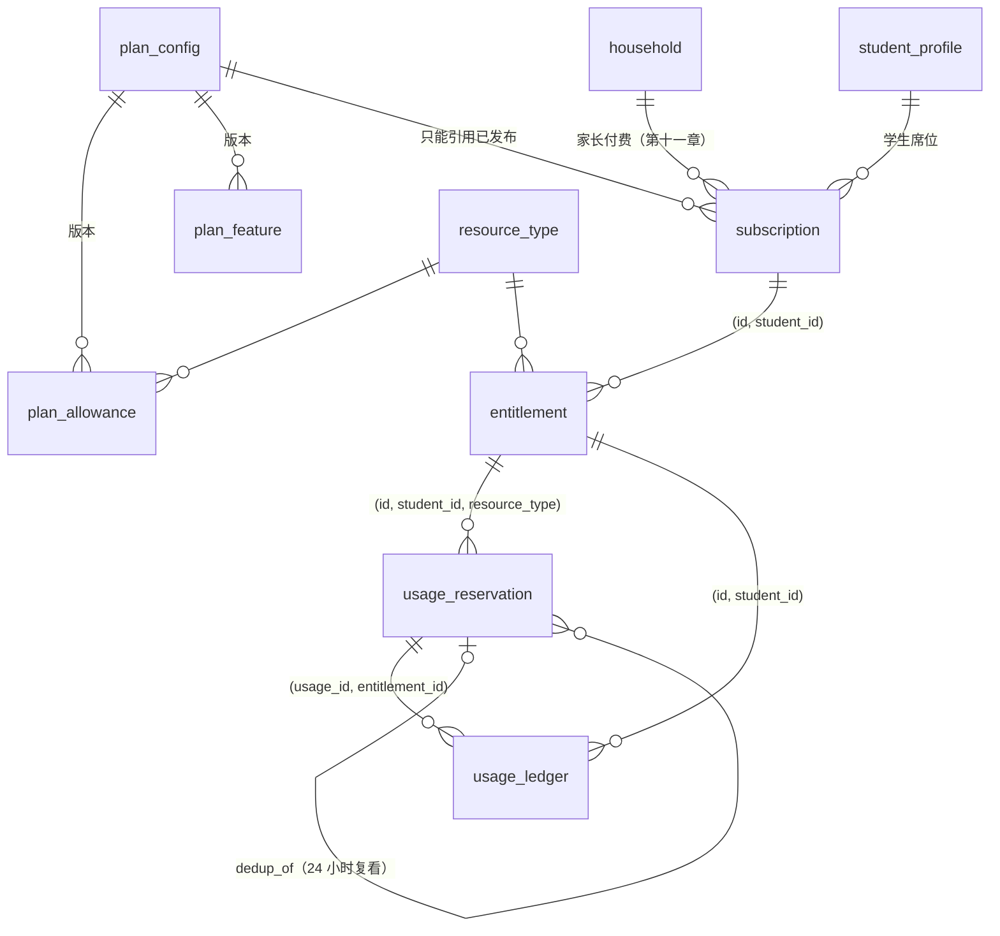
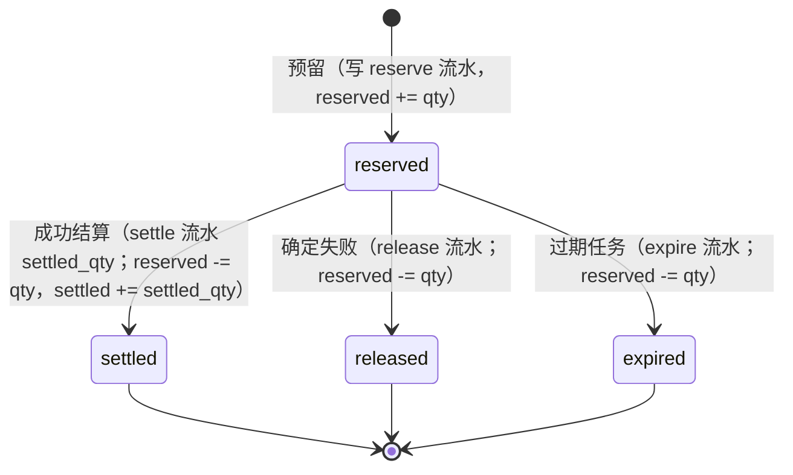
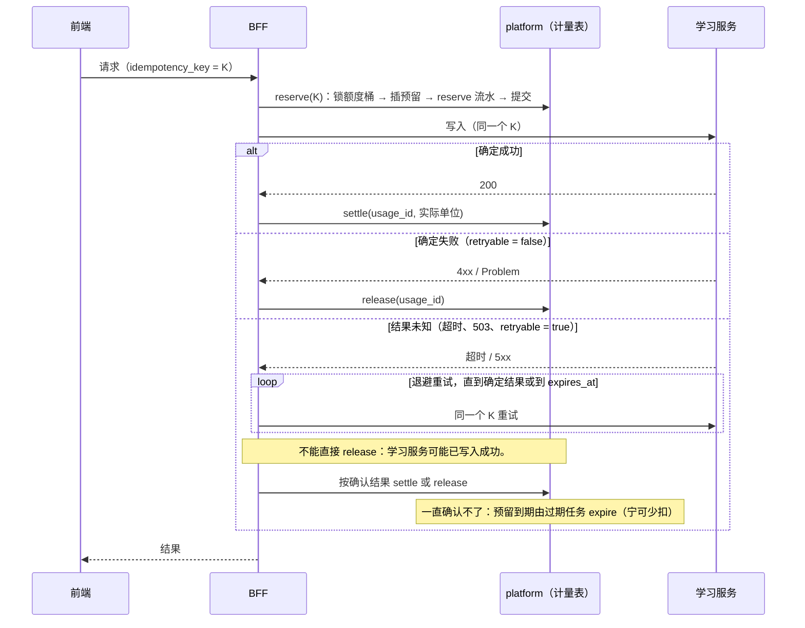

# 计量账本与权益 · 表结构设计（冲刺 1-E）

- 状态：**草稿，待评审签字**（开发计划冲刺 1-E 的验收就是本文档评审通过）
- spec：`specs/metering-schema-sprint1/spec.md`；实现记录与待人确认：同目录 `lessons.md`
- 迁移：`db/migrations/0008_platform__metering.{up,down}.sql`；测试：`db/tests/60_metering.sql`、`db/tests/mutations.sh`
- 依据：ADR 06（选项 A：Postgres 单库事务加追加式流水）、ADR 05（按月分区）、ADR 01（计量在 BFF 侧）、完整方案 5.8、5.9、第八章、第十一章
- CLAUDE.md 第 4 条：消耗类请求必须带 `usage_id` 与 `idempotency_key`，开始预留、成功结算、失败回滚

> [NEEDS-HUMAN] 迁移、RLS、计量与权益逻辑都是必停项。迁移由人执行，评审前不落到任何共享库。

本冲刺**只建表、约束、触发器、视图、RLS 和种子**。预留、结算、释放、过期、授予、调整六个函数在冲刺 2-E 实现，Gate 0 的六类测试也在 2-E。本文第 4、5 节是写给 2-E 的：每个场景靠哪条约束、哪把锁、哪个状态转换，2-E 可以照着写函数和测试。

---

## 1. 实体关系

| 表 | 作用 | 分区 | 谁能读（经 RLS） | 谁能写 |
|---|---|---|---|---|
| `resource_type` | 7 种计量资源：单位、取整、24 小时去重窗口、资源池、预留过期时间、单次上限 | 否 | BFF | 只有迁移 |
| `plan_config` | 额度配置版本：草稿 → 已发布 → 已停用 | 否 | BFF 只看非草稿 | 只有迁移或人工 |
| `plan_allowance` | (版本, 档位, 资源) → 每 30 天额度；公平使用上限标记 | 否 | BFF 只看非草稿版本 | 只能改草稿版本 |
| `plan_feature` | (版本, 档位, 权益) → 编码值 | 否 | 同上 | 同上 |
| `subscription` | 家庭 × 学生席位的订阅；来源 trial / pilot_virtual / paid / addon | 否 | 家长（已绑定）、学生本人 | 2-E 函数 |
| `entitlement` | 额度桶：学生 × 资源 × 30 天周期；三个计数 | 否 | 同上 | 2-E 函数 |
| `usage_reservation` | 预留与幂等（ADR 06 的 `usage_idempotency`） | **否**（幂等键要全局唯一） | 同上 | 2-E 函数 |
| `usage_ledger` | 流水：只追加，更正追加反向流水 | **按月**（UTC 月初） | 同上 | 2-E 函数 |

视图（都是 `security_invoker`，调用者的 RLS 生效）：
- `entitlement_balance`：有效或宽限订阅的当前周期余额，家长和学生看（完整方案 5.9“额度可见”）。
- `entitlement_reconciliation`：计数与流水、预留表不一致的额度桶。正常为零行。**不授权给 BFF**，给运维巡检。
- `reservation_ledger_mismatch`：流水条数不对的预留。正常为零行。同上。

**不存价格。**第八章：价格要等单位经济和监管路径核算之后再定。

---

## 2. 预留状态机

由 `guard_usage_reservation` 触发器保证：
- 只有 `reserved` 可以改，且只能改成三个终态之一。终态不能回退、不能互转、不能二次结算。
- 能改的只有 `state`、`settled_qty`、`finished_at`；归属、数量、指纹、过期时间一旦写入就不能改（不能“续期”）。
- 不能删除。

另有检查约束：
- 终态 ⇔ `finished_at` 非空；
- `settled` ⇔ `settled_qty` 非空；
- `settled_qty ≤ reserved_qty`：结算按实际单位，但不能超过预留。按分钟计的资源超出预留时，要另开一笔预留（见第 6 节）。

**已结算的退还不走状态机**：申诉成立、人工补偿都追加 `correction`（指向被更正的那条流水）或 `adjust` 流水，预留记录保持 `settled`。

---

## 3. 不变式清单

| # | 不变式 | 保证方式 | 测试 |
|---|---|---|---|
| I1 | 额度桶三个计数 = 流水与预留表的聚合（`granted` = grant + adjust + 它们的更正；`settled` = settle + 它的更正；`reserved` = 状态为 reserved 的预留数量之和） | `entitlement_reconciliation` 零行；2-E 每次写入后在同一事务里断言 | 60 §五–七；变异“对账不看预留”“对账不认更正” |
| I2 | 每笔预留恰好一条 `reserve` 流水；终态预留恰好一条终态流水 | `reservation_ledger_mismatch` 零行 | 60 §七 |
| I3 | `reserved + settled ≤ granted + fair_use_margin`，计数非负 | CHECK `entitlement_not_overdrawn` | 60 §四；变异“额度可以透支” |
| I4 | `idempotency_key` 全局唯一，跨月重试也挡得住 | 不分区表上的 UNIQUE | 60 §五；变异“幂等键可以重复” |
| I5 | 预留终态不可改，预留不可删 | 触发器 `guard_usage_reservation` | 60 §五；变异“预留终态可以再改” |
| I6 | 流水只追加 | 触发器 `reject_ledger_change`（分区继承）+ 任何角色没有 UPDATE / DELETE | 60 §六；变异“计量流水可以修改” |
| I7 | 预留的学生、资源类型与额度桶一致；流水的学生与额度桶一致；流水引用的预留属于同一额度桶 | 组合外键 | 60 §五、§六；三个外键变异 |
| I8 | 额度桶的学生与订阅一致；订阅的学生属于订阅的家庭；一个学生同时只有一个有效订阅（addon 除外） | 组合外键；触发器 `guard_subscription`；部分唯一索引 | 60 §三、§四 |
| I9 | 订阅只能引用已发布配置；已发布配置与其额度、权益只读；停用后不可恢复 | 触发器 `guard_subscription`、`guard_plan_config`、`guard_plan_rows` | 60 §二 |
| I10 | 任何应用角色对计量表没有直接写权限；学习服务、复核角色没有任何权限；流水分区不单独授权 | 授权 + RLS（ENABLE + FORCE） | 60 §八；多个授权变异 |
| I11 | 家长只能看已绑定学生（`guardian_student_link`），学生只看自己；同手机号不能跨档案 | RLS `platform.can_read_student(student_id)` | 60 §八；变异“家长可以看所有流水 / 额度桶”“余额视图以属主身份绕过 RLS” |
| I12 | 超出已建分区的流水直接失败，不进 DEFAULT 分区 | 不建 DEFAULT 分区（ADR 05 第 4 条要告警） | 60 §六；变异“流水加 DEFAULT 分区” |

---

## 4. Gate 0 六类场景走读（给 2-E）

约定：2-E 的函数都是 `SECURITY DEFINER`，属主 `starbuddy_authz`，一次调用一个事务。**加锁顺序固定为：先额度桶（`entitlement`），再预留（`usage_reservation`）**，所有函数都遵守，避免死锁。

### 场景 1：并发扣同一额度
- **做法**：`reserve()` 先 `SELECT … FROM entitlement WHERE id = $1 FOR UPDATE`，在锁内算 `granted + fair_use_margin − reserved − settled ≥ qty`，再插预留、写 reserve 流水、`reserved += qty`，一起提交。同一额度桶的并发预留在这把行锁上串行。
- **兜底**：即使函数漏了 `FOR UPDATE`，`UPDATE entitlement SET reserved = reserved + qty` 本身也会拿行锁并在最新行上重算，CHECK `entitlement_not_overdrawn` 让后到的那个事务失败（23514），不会透支。
- **2-E 测试**：额度只剩 1，两个连接同时预留 1。断言恰好一个成功；另一个得到“额度不足”；对账视图零行。

### 场景 2：预留后断线
- **做法**：预留在调用学习服务**之前**单独提交（ADR 01）。断线后预留停在 `reserved`，有 `expires_at`。
  - 客户端重连并用**同一个** `idempotency_key` 重试：走场景 3，拿回同一笔预留继续。
  - 客户端不再回来：走场景 5，到期释放。
- **不会多扣**：只有收到学习服务的确定成功才结算。
- **2-E 测试**：预留后不结算，断开连接；① 同 key 重试，断言没有第二笔预留、没有第二条 reserve 流水；② 不重试，推进时钟跑过期任务，断言额度退回。

### 场景 3：同一幂等键重试
- **做法**：`reserve()` 用 `INSERT … ON CONFLICT (idempotency_key) DO NOTHING RETURNING`；冲突时读出已有那笔：
  - `request_fingerprint` 不同 → 返回冲突（409），与学习服务同 key 不同请求体的口径一致；
  - 相同且 `reserved` → 返回同一 `usage_id`，调用方继续；
  - 相同且 `settled` → 返回首次结果，**不扣第二次**；
  - 相同且 `released` / `expired` → 返回该终态；学生主动重新发起算新的一次，要换新 key（5.8“学生主动重新发起完整分析计新一次”）。
- **兜底**：`idempotency_key` 在不分区表上全局唯一（I4）；每笔预留只能有一条 reserve、一条终态流水（I2）；终态不能再改（I5）。
- **2-E 测试**：同 key 连发 N 次（含并发），断言只有一笔预留、`settled` 只加一次；换请求体得到 409。

### 场景 4：结算前失败回滚
- **做法**：学习服务返回**确定失败**（`retryable = false`，或契约规定的 4xx）→ `release()`：锁额度桶、锁预留，`reserved → released`，写 release 流水，`reserved -= qty`。
- **不能 release 的情况**：学习服务返回可重试错误或超时，属于“结果未知”，见第 5 节。已结算的不能 release（I5），退还走 `correction`。
- **2-E 测试**：学习服务模拟 422 → 额度退回、流水有 reserve + release 两条、对账零行；模拟 503 → 预留仍是 `reserved`。

### 场景 5：预留过期释放
- **做法**：定时任务（ADR 03 调度）按 `usage_reservation_expiry_idx` 找 `state = 'reserved' AND expires_at < now()`，逐笔调用 `expire()`：按固定顺序加锁，**加锁后重新检查仍是 `reserved`**，再 `reserved → expired`、写 expire 流水、`reserved -= qty`。批量扫描用 `FOR UPDATE SKIP LOCKED`，不阻塞正在结算的请求。
- **与迟到的成功竞争**：结算和过期都要锁同一笔预留。谁先提交谁生效，后到的撞上终态触发器（23514）：
  - 过期先：迟到的成功不再扣费，**宁可少扣不多扣**。BFF 记一条 `late_success_after_expiry` 指标，由人工决定是否补记（`adjust`）。
  - 结算先：过期任务重查发现已是终态，跳过。
- **2-E 测试**：预留后推进时钟过期，断言额度退回；过期后再结算，断言失败且不扣。

### 场景 6：24 小时内复看同一内容
- **做法**：只对 `resource_type.dedup_window` 非空的资源（目前只有 `mistake_analysis`）生效。
  - `dedup_key` = `sha256(household_id ‖ resource_type ‖ content_fingerprint)` 的十六进制，`content_fingerprint` 由各科适配器提供（ADR 06 第 3 条）。
  - `reserve()` 在锁额度桶之后，按 `usage_reservation_dedup_idx` 找 `dedup_key` 相同、`state = 'settled'`、`settled_qty > 0`、`finished_at > now() − dedup_window` 的首次记录。
  - 找到：插一笔 `reserved_qty = 0`、`dedup_of = 首次 usage_id` 的预留，结算时写数量为 0 的 reserve、settle 流水。留痕，不扣次。
- **并发的两次“首次”**：同一家庭同一内容几乎同时发起，两边都可能查不到首次而各扣一次。2-E 在查找前加 `pg_advisory_xact_lock(hashtextextended(dedup_key, 0))`，把同一 `dedup_key` 串行化。
- **兜底**：`dedup_of` 必须带 `dedup_key`（CHECK）；`dedup_of` 指向真实预留（外键）。
- **2-E 测试**：首次扣 1；23 小时后复看扣 0，且 `dedup_of` 指向首次；25 小时后再看扣 1；两个连接同时首次，断言只扣 1。

本冲刺的数据库测试已用超级用户模拟了场景 3、4、5、6 的数据形态（60 §五）：终态转换、同 key 唯一、结算 0 的复看、释放与过期退回，每一步之后两个对账视图都是零行。

---

## 5. 与学习服务“结果未知”的对接

学习服务 1-C 的约定（已写进 `learning-internal.v0.yaml`）：可重试错误表示结果未知，调用方必须用**同一个 key** 重试确认。本设计的幂等键与学习服务共用（spec 待人确认 #5 默认）：同一次用户动作只有一个 `idempotency_key`，BFF 用它预留，也原样传给学习服务和适配器。

要点：
- **预留单独提交**，不和学习服务调用放在同一个数据库事务里（跨服务调用不能持有行锁）。
- **重试窗口要短于预留过期时间**。`resource_type.reservation_ttl` 的草案值按 ADR 06 待确认 #3 取 p99 的约 2 倍，待产品确认。
- 过期任务不访问学习服务（计量表和学习服务的表互不授权）。过期即视为“没确认成功”，少扣由指标 `late_success_after_expiry` 暴露。
- 流水的 `source_method`、`source_idempotency_key` 记录业务来源，家长查“这次扣了什么”时可以回溯到具体的判分或诊断（ADR 06 后果第 2 条）。

---

## 6. 其他设计决定

- **额度挂在学生席位上**（spec 待人确认 #1 默认）：订阅挂家庭（家长付费），额度桶按学生分。第二个孩子单独买席位（第八章）。
- **周期滚动 30 天**（#2 默认）：从订阅开始日起算，`entitlement.period_start/period_end` 与订阅周期一致；续期时新建下一周期的额度桶和 grant 流水，旧桶保留。
- **公平使用上限硬停**（#3 默认）：`fair_use_margin` 默认 0，MAX 的 AI 互动时长到 4,000 分钟即停，统一壳提供低成本自练题入口。允许少量超用时，只需由 2-E 的授予函数写入非零余量，不改表。
- **升级当日补差，降级到期生效**（第八章脚注）：升级 = 改订阅档位 + 对当前周期各桶追加 `adjust` 流水（`granted += 差额`），不改原有的 grant；降级写成下一周期生效。改订阅的配置版本时同样只能指向已发布配置。
- **试点虚拟额度按 PRO 发放，全量走账本**（#7 默认）：`source = 'pilot_virtual'`，与付费走完全相同的表和函数，便于测算单位经济（开发计划 M5）。
- **按分钟计的资源**：结算按分钟向上取整（`resource_minute_rounds_up`），单次预留不超过 `max_per_reservation`（语音、AI 时长为 30 分钟）。长会话由 2-E 按段预留、按段结算。
- **流水的 `actor`**：`bff`（用户请求）、`system`（定时任务：过期、周期授予）、`staff`（人工更正、补偿）。
- **分区**：`usage_ledger` 与 `evidence_event` 同样用 `platform.ensure_monthly_partitions`，初始为 2026-09 起 16 个月；续建由调度任务负责（ADR 05）。
- **保留期**：流水是交易记录，保留期可能与学习证据不同（ADR 09），待合规意见（#8）。本迁移不做清理。

## 7. 不在本冲刺
- 六个写入函数、BFF 代码、Gate 0 六类测试（2-E）。
- 选科上限函数（spec 待人确认 #6 默认放到 2-E）：`subject_enrollment` 改为只能经函数写入，按当前订阅 `plan_feature.max_active_subjects` 校验。
- 支付、订单、退款、价格；AI 互动有效时长的计时口径；token 成本闸门；附加权益的配置（表结构已预留 `source = 'addon'`）。

---

## 签字

| 角色 | 结论（通过 / 修改后通过 / 不通过） | 签字 | 日期 |
|---|---|---|---|
| 技术负责人 | | | |
| 产品负责人（额度种子、过期时间、公平使用口径） | | | |
| 资深工程师（ADR 06 决策人） | | | |
