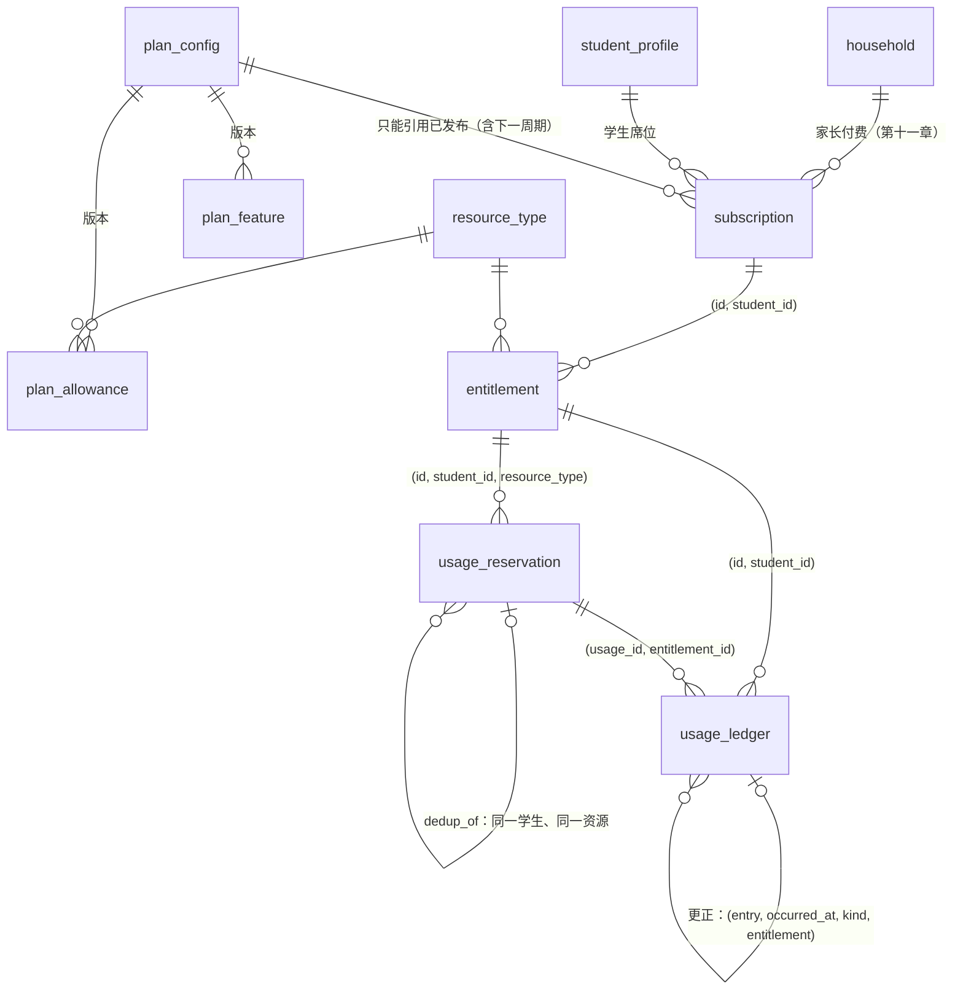
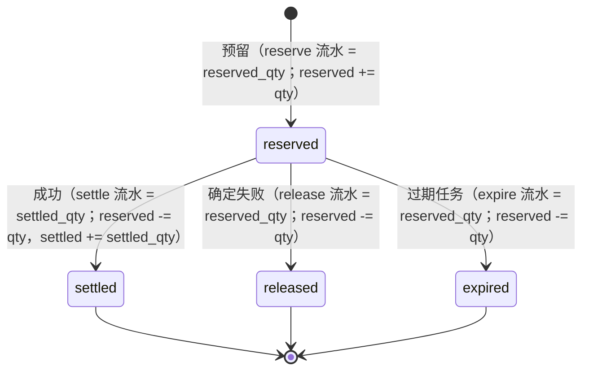
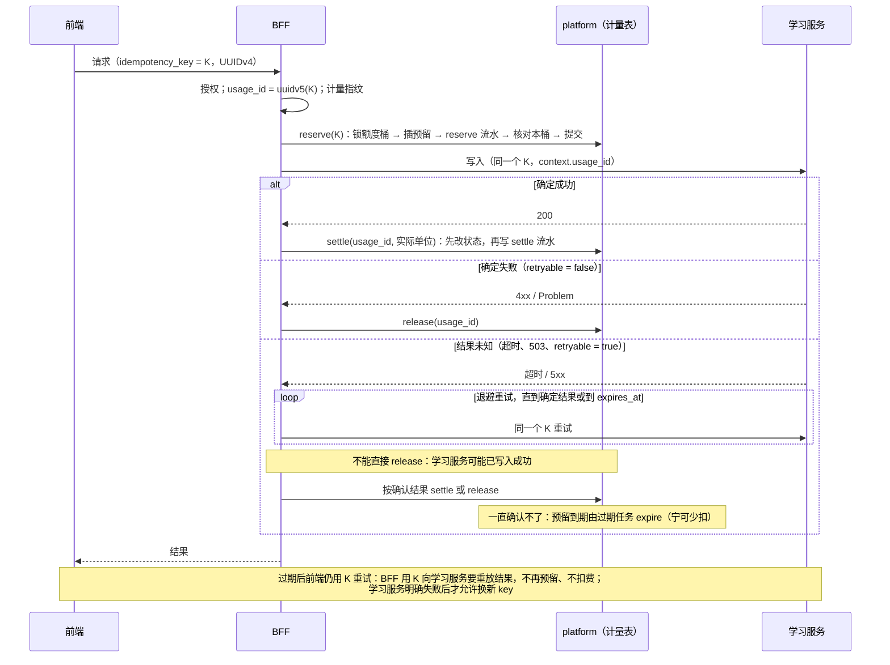

# 计量账本与权益 · 表结构设计（冲刺 1-E）

- 状态：**草稿，待评审签字**（开发计划冲刺 1-E 的验收就是本文档评审通过）
- spec：`specs/metering-schema-sprint1/spec.md`；实现记录与待人确认：同目录 `lessons.md`
- 迁移：`db/migrations/0008_platform__metering.{up,down}.sql`；测试：`db/tests/60_metering.sql`、`db/tests/mutations.sh`
- 依据：ADR 06（选项 A：Postgres 单库事务加追加式流水）、ADR 05（按月分区）、ADR 01（计量在 BFF 侧）、完整方案 5.8、5.9、第八章、第十一章
- CLAUDE.md 第 4 条：消耗类请求必须带 `usage_id` 与 `idempotency_key`，开始预留、成功结算、失败回滚

> [NEEDS-HUMAN] 迁移、RLS、计量与权益逻辑都是必停项。迁移由人执行，评审前不落到任何共享库。

本冲刺**只建表、约束、触发器、视图、RLS 和种子**。预留、结算、释放、过期、授予、调整六个函数在冲刺 2-E 实现，Gate 0 的六类测试也在 2-E。

第 4、5 节是写给 2-E 的：每个场景靠哪条约束、哪把锁、哪个状态转换，2-E 可以照着写函数和测试。数据库层能挡住的都已经挡住（第 3 节），函数写错了也不会静默多扣。

---

## 1. 实体关系

| 表 | 作用 | 分区 | 谁能读（经 RLS） | 谁能写 |
|---|---|---|---|---|
| `resource_type` | 7 种计量资源：单位、取整、24 小时去重窗口、资源池、预留过期时间、单次上限 | 否 | BFF | 只有迁移 |
| `plan_config` | 额度配置版本：草稿 → 已发布 → 已停用；发布时必须齐全 | 否 | BFF 只看非草稿 | 只有迁移或人工 |
| `plan_allowance` | (版本, 档位, 资源) → 每 30 天额度（整数）；公平使用上限标记 | 否 | BFF 只看非草稿版本 | 只能改草稿版本 |
| `plan_feature` | (版本, 档位, 权益) → 编码值 | 否 | 同上 | 同上 |
| `subscription` | 家庭 × 学生席位；来源 trial / pilot_virtual / paid / addon；当前周期；下一周期的档位与配置（降级） | 否 | 家长（已绑定）、学生本人 | 2-E 函数 |
| `entitlement` | 额度桶：学生 × 资源 × 周期；三个计数与公平使用余量 | 否 | 同上 | 2-E 函数 |
| `usage_reservation` | 预留与幂等（ADR 06 的 `usage_idempotency`） | **否**（幂等键要全局唯一） | 同上，**只开放展示列**（不含幂等键、指纹、去重键） | 2-E 函数 |
| `usage_ledger` | 流水：只追加，更正追加反向流水 | **按月**（UTC 月初） | 同上 | 2-E 函数 |

视图（都是 `security_invoker`，调用者的 RLS 生效）：
- `entitlement_balance`：有效或宽限订阅的当前周期余额，包括公平使用余量，按订阅来源分行。给家长和学生看（完整方案 5.9“额度可见”）。
- `entitlement_reconciliation`：计数与流水、预留表不一致的额度桶。正常为零行。**不授权给 BFF**，给运维巡检。
- `reservation_ledger_mismatch`：流水与预留在条数、种类、数量上对不上的预留。正常为零行。同上。

**不存价格。**第八章：价格要等单位经济和监管路径核算之后再定。

---

## 2. 预留状态机

**新建预留**（`guard_usage_reservation` 触发器）：
- 只能以 `reserved` 状态写入；
- `reserved_qty ≤ resource_type.max_per_reservation`；
- `expires_at ≤ reserved_at + resource_type.reservation_ttl`；
- 复看（`dedup_of` 非空）：数量为 0；带去重键；引用的是**同一学生、同一资源**（外键）、**同一去重键**、**已结算且扣过费**（`settled_qty > 0`）、在去重窗口内的首次记录。

**推进状态**（同一触发器）：
- 只有 `reserved` 可以改，而且只能改成三个终态之一。终态不能回退、不能互转、不能二次结算。
- 只能改 `state`、`settled_qty`、`finished_at`。归属、额度桶、数量、指纹、过期时间都不能改（不能续期、不能挪桶）。
- 不能删除，不能 TRUNCATE。

**检查约束**：
- 终态 ⇔ `finished_at` 非空；`settled` ⇔ `settled_qty` 非空；
- `settled_qty ≤ reserved_qty`；
- 所有数量都是整数：按次计本来就是整数，按分钟计的先向上取整。

**流水的写入核对**（`guard_ledger_insert` 触发器，每条带 `usage_id` 的流水）：
- `reserve` 数量 = `reserved_qty`，每笔预留只有一条；
- `settle` 只能写给 `settled` 的预留，数量 = `settled_qty`；
- `release`、`expire` 只能分别写给 `released`、`expired` 的预留，数量 = `reserved_qty`；
- 每笔预留至多一条终态流水。

所以 2-E 的函数必须**先改预留状态，再写终态流水**，在同一事务里完成。

**已结算的退还不走状态机**：申诉成立、人工补偿都追加 `correction` 或 `adjust` 流水，预留保持 `settled`。更正的约束：
- 目标流水真实存在、种类属实、属于同一额度桶（组合自引用外键）；
- 只能更正 `grant`、`adjust`、`settle`；
- 方向与原流水相反；
- 同一条流水的累计更正不越过零，所以不能重复退款，也不能借更正多扣。

---

## 3. 不变式清单

| # | 不变式 | 保证方式 | 测试 |
|---|---|---|---|
| I1 | 额度桶三个计数 = 流水与预留表的聚合 | `entitlement_reconciliation` 零行；2-E 每次写入后只核对当前桶（见第 4 节） | 60 §五–七；变异“对账不看预留”“对账不认更正” |
| I2 | 每笔预留：恰好一条 reserve 流水且数量相等；终态恰好一条种类、数量都对应的终态流水 | `guard_ledger_insert`（写入时拦截）+ `reservation_ledger_mismatch`（事后巡检） | 60 §五、§七；变异“流水不按预留核对”“预留对账只数条数不核数量” |
| I3 | `reserved + settled ≤ granted + fair_use_margin`，计数非负且为整数 | CHECK | 60 §四；变异“额度可以透支” |
| I4 | `idempotency_key` 全局唯一，跨月重试也挡得住 | 不分区表上的 UNIQUE | 60 §五；变异“幂等键可以重复” |
| I5 | 预留只能以 reserved 开始；终态不可改；只有三列可变；不可删、不可 TRUNCATE | `guard_usage_reservation`、TRUNCATE 触发器 | 60 §五、§六；变异“预留终态可以再改”“推进终态时可换额度桶 / 可改过期时间”“预留可以直接以终态写入” |
| I6 | 单次预留不超过上限，过期时间不超过资源配置 | `guard_usage_reservation` | 60 §五；两个对应变异 |
| I7 | 流水只追加：不能 UPDATE、DELETE、TRUNCATE（表属主也不行；分区被自引用外键引用，不能单独 TRUNCATE） | 触发器 + 任何角色都没有写权限 | 60 §六；变异“计量流水可以修改”“流水可以 TRUNCATE” |
| I8 | 更正：目标存在、种类属实、同一额度桶、反向、累计不越过零 | 组合自引用外键 + `guard_ledger_insert` | 60 §六；变异“更正目标没有外键”“更正方向不校验”“更正累计不校验” |
| I9 | 流水按种类限定操作者：grant 只由 system，correction 只由 staff，expire 只由 system | CHECK `ledger_actor_by_kind` | 60 §五、§六 |
| I10 | 预留、流水的学生与资源类型和额度桶一致；流水引用的预留属于同一额度桶 | 组合外键 | 60 §五、§六 |
| I11 | 额度桶：学生与订阅一致；周期落在订阅周期内；同一订阅同一资源的周期不重叠；建立后归属与周期不能改；不能删 | 组合外键 + `guard_entitlement` | 60 §四；变异“额度桶身份与周期可改” |
| I12 | 订阅：学生属于该家庭；一个学生同时只有一个有效订阅（addon 除外）；结束是终态；周期只能向后推进；家庭、学生、来源不能改；周期不超过 31 天 | `guard_subscription`、部分唯一索引、CHECK | 60 §三 |
| I13 | 订阅（含下一周期的降级）只能引用已发布配置；已发布配置与其额度、权益只读；发布时 4 档 × 全部资源 × 4 项权益必须齐全；停用后不可恢复 | `guard_subscription`、`guard_plan_config`、`guard_plan_rows`，并用 advisory 锁把“发布”与“改额度行、开订阅”串行化 | 60 §二；变异“不完整配置可以发布”“额度行可在配置间挪动” |
| I14 | 复看只能引用同一学生、同一资源、同一内容、扣过费、在窗口内的首次 | 外键 `reservation_dedup_same_student_fk` + 触发器 | 60 §五；变异“复看可以跨学生引用”“复看可以指向没扣费的记录” |
| I15 | 任何应用角色对计量表都没有直接写权限；学习服务、复核角色没有任何权限；流水分区不单独授权 | 授权 + RLS（ENABLE + FORCE） | 60 §八 |
| I16 | 家长只能看已绑定的学生（`guardian_student_link`），学生只看自己；同手机号不能跨档案；BFF 读不到幂等键和指纹 | RLS `platform.can_read_student(student_id)` + 预留表按列授权 | 60 §八；变异“家长可以看所有流水 / 额度桶”“预留对所有登录用户可读”“余额视图以属主身份绕过 RLS”“BFF 可以读幂等键” |
| I17 | 超出已建分区的流水直接失败，不进 DEFAULT 分区 | 不建 DEFAULT 分区（ADR 05 第 4 条要告警） | 60 §六 |
| I18 | 保护触发器都不是 SECURITY DEFINER，也不对 PUBLIC 开放执行 | `REVOKE EXECUTE … FROM PUBLIC` | 60 §八 |

---

## 4. Gate 0 六类场景走读（给 2-E）

### 4.0 所有函数共同遵守的规则

- **授权从当前账号推导**。
  - 函数只接受 `student_id`，按 `platform.is_self_student` 或 `platform.is_linked_guardian` 判断当前账号能否为这个学生发起消耗。家长能发起哪些动作由产品定。
  - 额度桶在函数内部按“学生 + 资源 + 当前周期 + 有效订阅”查出来，**不接受外部传入的 `entitlement_id` 或 `usage_id`**。
  - 组合外键只能保证桶和学生一致，挡不住“同时传入别人的学生和桶”，所以授权必须在函数里做。
- **幂等键**：
  - 由前端为每次用户动作生成 UUIDv4，重试时原样复用。
  - 服务端校验它的格式。
  - `usage_id` 由 key 确定性派生：`uuidv5(计量命名空间, key)`。这样 BFF 在预留之前就知道 `usage_id`，也就能按契约把它放进发给学习服务的请求体里。
- **加锁顺序固定为：先额度桶，再预留。**
  - 批量扫描（过期任务）**不加锁**，只取 `usage_id`；
  - 逐笔处理时先锁额度桶，再锁预留，并重查状态。
  - 这样与结算、释放的加锁顺序一致，不会死锁。
- **终态操作幂等**：`settle()`、`release()` 遇到“已经是同一终态”，返回首次结果，不报错；遇到“已经是另一个终态”，返回冲突。否则同 key 并发重试时，第二个请求会撞上 23514，被 BFF 误判为失败。
- **对账**：每次写入后在同一事务里**只核对当前额度桶**。2-E 提供按桶的核对函数，不去扫全表视图。全表视图留给运维巡检。

### 场景 1：并发扣同一额度
- **做法**：`reserve()` 先 `SELECT … FROM entitlement WHERE id = $1 FOR UPDATE`，在锁内算 `granted + fair_use_margin − reserved − settled ≥ qty`，再插预留、写 reserve 流水、`reserved += qty`，一起提交。同一额度桶的并发预留在这把行锁上串行。
- **兜底**：即使函数漏了 `FOR UPDATE`，`UPDATE entitlement SET reserved = reserved + qty` 本身也会拿行锁并在最新行上重算，CHECK `entitlement_not_overdrawn` 让后到的事务失败，不会透支。
- **2-E 测试**：额度只剩 1，两个连接同时预留 1。断言恰好一个成功，另一个得到“额度不足”，对账为零行。

### 场景 2：预留后断线
- **做法**：预留在调用学习服务**之前**单独提交（ADR 01）。断线后预留停在 `reserved`，带 `expires_at`。
  - 客户端重连，用**同一个** key 重试：走场景 3，拿回同一笔预留继续。
  - 客户端不再回来：走场景 5，到期释放。
- **不会多扣**：只有收到学习服务的确定成功才结算。
- **2-E 测试**：预留后断开，不结算。① 同 key 重试，断言没有第二笔预留，也没有第二条 reserve 流水。② 不重试，推进时钟跑过期任务，断言额度退回。

### 场景 3：同一幂等键重试
- **计量指纹**：把请求体规范化，去掉 `request_id` 和 `usage_id` 后算 SHA-256。规范化复用共享库 `starbuddy_contract` 的 `canonical()`，与学习服务同一套规则。不去掉 `usage_id` 会出问题：它是预留的产物，计量指纹必须在预留之前就能算。2-E 要提供两边共用的测试向量。
- **做法**：`reserve()` 用 `INSERT … ON CONFLICT (idempotency_key) DO NOTHING RETURNING`；冲突时读出已有的那笔：
  - 学生、资源类型或计量指纹有任何一项不同 → 返回 409，不透露已有那笔的任何信息；
  - 都相同且为 `reserved` → 返回同一个 `usage_id`，调用方继续；
  - 都相同且为 `settled` → 返回首次结果，**不扣第二次**；
  - 都相同且为 `released` 或 `expired` → 按第 5 节处理，不能直接让前端换新 key。
- **兜底**：key 在不分区表上全局唯一（I4）；每笔预留只有一条 reserve 流水、至多一条终态流水（I2）；终态不能再改（I5）。
- **2-E 测试**：
  - 同 key 连发 N 次，包括并发：断言只有一笔预留，`settled` 只加一次；
  - 换请求体、换学生分别重发：断言都得到 409。

### 场景 4：结算前失败回滚
- **做法**：学习服务返回**确定失败**（`retryable = false`，或契约规定的 4xx）→ `release()`：锁额度桶，锁预留，把 `reserved` 改成 `released`，写 release 流水，`reserved -= qty`。
- **不能 release 的情况**：
  - 学习服务返回可重试错误或超时，属于“结果未知”，见第 5 节；
  - 已结算的预留不能 release（I5），退还走 `correction`。
- **兜底**：release 流水只能写给 `released` 的预留，数量必须等于预留数量（I2）。
- **2-E 测试**：学习服务模拟 422 → 额度退回，流水有 reserve 和 release 两条，对账为零行；模拟 503 → 预留仍是 `reserved`。

### 场景 5：预留过期释放
- **做法**：定时任务（ADR 03 调度）按 `usage_reservation_expiry_idx` 取出 `state = 'reserved' AND expires_at < now()` 的 `usage_id`，逐笔调用 `expire()`：按固定顺序加锁，重查状态仍是 `reserved`，再改成 `expired`，写 expire 流水（actor 为 `system`），`reserved -= qty`。
- **与迟到的成功竞争**：结算和过期都要锁同一笔预留，谁先提交谁生效。
  - 过期先：迟到的成功**不再扣费**，宁可少扣不多扣。BFF 记一条 `late_success_after_expiry` 指标，不自动补记。如果人工决定补记，就新开一笔预留再结算，reason 写 `late_success`；不用 `adjust`，因为 `adjust` 计入的是已授予，不是已用。
  - 结算先：过期任务重查发现已是终态，跳过。
- **过期后同 key 重试**：学习服务可能已经用这个 key 写入成功，所以 BFF **仍用原 key** 调学习服务，拿重放的结果，不扣费。只有学习服务明确返回失败（`retryable: false`）之后，才允许前端换新 key 重新发起。换 key 太早，学习服务会把它当成新请求，重复判分、重复写证据。
- **已知缺口（待人确认）**：学习服务对“之前失败过”的同 key 请求会接管并重新执行（`services/learning` 的 store）。所以过期后的重试，可能在没有预留的情况下执行一次。要堵住这个缺口，需要学习服务提供“只查询、不执行”的重放接口，这是契约变更，见 lessons。
- **2-E 测试**：预留后推进时钟到过期，断言额度退回；过期后再结算，断言失败且不扣；过期后同 key 重试，断言学习服务收到的仍是原 key。

### 场景 6：24 小时内复看同一内容
- **适用范围**：只对 `resource_type.dedup_window` 非空的资源生效，目前只有 `mistake_analysis`。这类资源单次预留上限是 1，一笔预留只对应一道题。
- **内容指纹**：由 **BFF 在调用学习服务之前**算，不依赖适配器，也不改契约。
  - 上传的错题图片：对原始字节算 SHA-256；
  - 题库题：直接用 `item_ref`；
  - 格式：`<来源>:<摘要>`。
- **去重键**：`dedup_key = sha256(student_id ‖ resource_type ‖ content_fingerprint)`，**按学生**去重。
- **做法**：`reserve()` 先锁额度桶，再对这个 `dedup_key` 取 `pg_advisory_xact_lock`，然后按 `usage_reservation_dedup_idx` 查找：
  - 有**仍在 `reserved`** 的同键记录 → 返回 409 `DEDUP_IN_PROGRESS`，让客户端稍后用同一个 key 重试。这样能防止“首次还没结算，复看又扣一次”。advisory 锁在预留提交时就释放了，单靠它挡不住。
  - 有窗口内、`settled` 且 `settled_qty > 0` 的首次 → 插一笔 `reserved_qty = 0`、`dedup_of = 首次 usage_id` 的预留，结算时写数量为 0 的 reserve 和 settle 流水。留痕，但不扣次。
  - 都没有 → 正常扣费。
- **兜底**：`dedup_of` 必须同一学生、同一资源（外键），同一去重键、扣过费、在窗口内（触发器），数量为 0（CHECK）。
- **2-E 测试**：
  - 首次扣 1；23 小时后复看扣 0，`dedup_of` 指向首次；25 小时后再看扣 1。
  - 首次仍在处理时复看 → 409。
  - 两个连接同时首次 → 只扣 1。
  - 兄弟姐妹看同一题 → 各扣各的。

本冲刺的数据库测试用超级用户模拟了场景 3、4、5、6 的数据形态（60 §五）：终态转换、同 key 唯一、结算为 0 的复看、释放与过期退回。每一步之后，两个对账视图都是零行。

---

## 5. 与学习服务“结果未知”的对接

学习服务 1-C 的约定已写进 `learning-internal.v0.yaml`：可重试错误表示结果未知，调用方必须用**同一个 key** 重试确认。本设计的幂等键与学习服务共用（spec 待人确认 #5 的默认）。

要点：
- **预留单独提交**，不和学习服务调用放在同一个数据库事务里，因为跨服务调用期间不能一直持有行锁。
- **重试窗口要短于预留过期时间**。完整诊断、模考、讲评课都在**提交时**预留，不是开始作答时，所以过期时间按处理时长定，不按作答时长。各项的草案值待产品确认。
- 过期任务不访问学习服务：计量表和学习服务的表互不授权。过期就视为“没确认成功”，少扣由 `late_success_after_expiry` 指标暴露。
- 流水的 `source_method`、`source_idempotency_key` 记录业务来源，家长查“这次扣了什么”时可以回溯到具体的判分或诊断（ADR 06 后果第 2 条）。

### 资源类型、契约方法与 key 的对应

| 资源 | 契约方法 | 一笔预留对应的学习服务调用 | 学习服务 key |
|---|---|---|---|
| `diagnosis_screen`、`diagnosis_full` | `diagnose` | 1 次 | K |
| `mistake_analysis` | `grade` | 1 次（一道题） | K |
| `mock_exam` | `grade` | N 次（每道题一次） | `K:<序号>` |
| `lesson_whiteboard` | `teach` | 1 次 | K（学习服务尚无 teach 写入接口，待接入） |
| `voice_realtime`、`ai_active_time` | `teach`、`grade` | 按段预留，每段 N 次 | `K:<序号>` |

流水里记录的是预留的 key K。一对多时，各次调用的 key 可以按规则推回来，所以不另建关联表。`source_method` 只取契约里的消耗类方法：`diagnose`、`grade`、`teach`。

---

## 6. 其他设计决定

- **额度挂在学生席位上**（spec 待人确认 #1 的默认）：订阅挂家庭（家长付费），额度桶按学生分。第二个孩子单独买席位（第八章）。
- **周期滚动 30 天**（#2 的默认）：订阅和额度桶的周期都不超过 31 天。额度桶的周期落在订阅当前周期内。续期时推进订阅周期，并新建下一周期的额度桶和 grant 流水，旧桶保留。
- **公平使用上限硬停**（#3 的默认）：`fair_use_margin` 默认 0，MAX 的 AI 互动时长到 4,000 分钟即停，统一壳提供低成本自练题入口。如果以后允许少量超用，只需由 2-E 的授予函数写入非零余量，余额视图已经计入余量，不用改表。
- **升级当日补差，降级到期生效**（第八章脚注）：
  - 升级：改订阅的档位和配置（只能是已发布的），同时对当前周期的各个桶追加 `adjust` 流水（actor 为 `system`，`granted += 差额`），不改原有的 grant。档位变化的历史通过 adjust 流水的 reason 留存。
  - 降级：写入 `next_tier`、`next_config_version`（只能是已发布的），续期时生效。
- **试点虚拟额度按 PRO 发放，全量走账本**（#7 的默认）：`source = 'pilot_virtual'`，与付费走完全相同的表和函数，便于测算单位经济（开发计划 M5）。来源一旦写入不能改。
- **按分钟计的资源**：结算按分钟向上取整；单次预留不超过 `max_per_reservation`（语音、AI 时长为 30 分钟）。长会话由 2-E 按段预留、按段结算。
- **流水的 `actor`**：
  - `bff`：用户请求；
  - `system`：定时任务，包括过期、周期授予、升级补差；
  - `staff`：人工更正、补偿。
- **多个额度桶时先扣哪个**（主订阅与附加权益）：由 2-E 决定。余额视图按来源分行显示。
- **分区**：`usage_ledger` 与 `evidence_event` 一样用 `platform.ensure_monthly_partitions`，初始为 2026-09 起 16 个月，续建由调度任务负责（ADR 05）。分区本身没有开 RLS，靠“分区不单独授权”保护（I15）。
- **保留期**：流水是交易记录，保留期可能与学习证据不同（ADR 09），待合规意见（#8）。本迁移不做清理。流水与学生档案之间没有级联删除，与未成年人删除权怎么协调，一并待合规确认。

## 7. 不在本冲刺，以及 2-E 必须做的
- 六个写入函数、BFF 代码、Gate 0 六类测试。
- **授权**：2-E 给 `starbuddy_authz` 授权时，只授必要的部分：
  - `usage_ledger` 的 INSERT；
  - `usage_reservation` 的 INSERT，以及 `state`、`settled_qty`、`finished_at` 三列的 UPDATE；
  - `entitlement` 的 INSERT，以及计数列的 UPDATE；
  - `subscription` 的 INSERT，以及可变列的 UPDATE；
  - 保护触发器要读的表的 SELECT，因为这些触发器以调用者身份执行。

  同时把 60 §八里“授权函数属主读不到”的断言改写成按列精确比对。
- 选科上限函数（spec 待人确认 #6 的默认是放到 2-E）：`subject_enrollment` 改为只能经函数写入，按当前订阅的 `plan_feature.max_active_subjects` 校验。
- 支付、订单、退款、价格；AI 互动有效时长的计时口径；token 成本闸门；附加权益的配置（表结构已预留 `source = 'addon'`）。

---

## 签字

| 角色 | 结论（通过 / 修改后通过 / 不通过） | 签字 | 日期 |
|---|---|---|---|
| 技术负责人 | | | |
| 产品负责人（额度种子、过期时间、公平使用口径、去重范围） | | | |
| 资深工程师（ADR 06 决策人） | | | |
